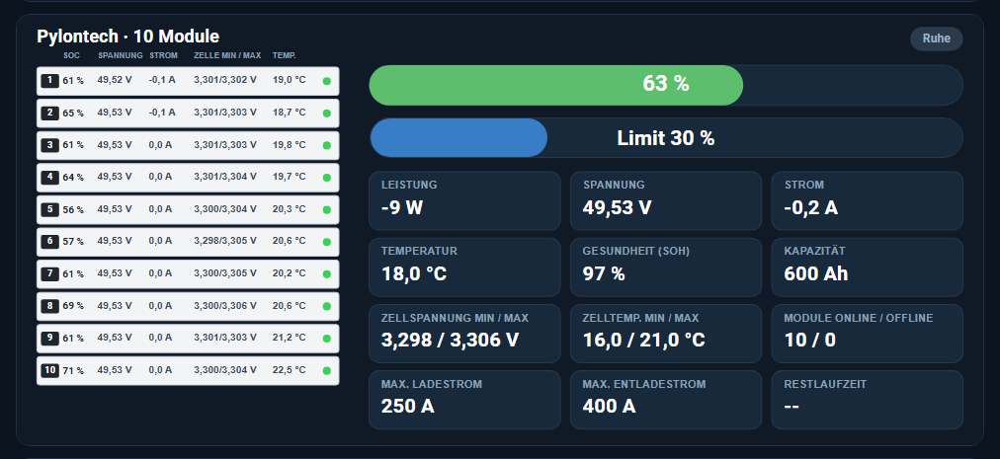

# Pylontech Card

A Home Assistant dashboard card for a **Pylontech battery stack**: big SoC bar, optional ESS minimum-SoC slider, every module with SoC / voltage / current / cell min-max / temperature, and the BMS values as tiles.
*Deutsch weiter unten.*



Switches automatically between desktop (modules left, tiles right) and phone layout. Tap any value to open its entity. German and English.

Part of the Victron set: [victron-solar-cards](https://github.com/ossilampe/victron-solar-cards) · [lynx-card](https://github.com/ossilampe/lynx-card)

## Installation

**HACS / Marketplace:** add `https://github.com/ossilampe/pylontech-card` as a custom repository of type **Dashboard**, install, reload the browser.
**Manual:** copy `pylontech-card.js` to `/config/www/`, add resource `/local/pylontech-card.js?v=1.0.0` (JavaScript module).

## Configuration

```yaml
type: custom:pylontech-card
title: Pylontech
soc: sensor.pylontech_soc
power: sensor.pylontech_power
voltage: sensor.pylontech_voltage
current: sensor.pylontech_current
temperature: sensor.pylontech_temperature
soh: sensor.pylontech_soh
capacity: sensor.pylontech_capacity
cell_voltage_min: sensor.pylontech_cell_voltage_min
cell_voltage_max: sensor.pylontech_cell_voltage_max
cell_temp_min: sensor.pylontech_cell_temp_min
cell_temp_max: sensor.pylontech_cell_temp_max
modules_online: sensor.pylontech_modules_online
modules_offline: sensor.pylontech_modules_offline
max_charge_current: sensor.pylontech_max_charge_current
max_discharge_current: sensor.pylontech_max_discharge_current
battery_state: sensor.battery_state          # charging / discharging / idle
time_to_go: sensor.battery_time_to_go        # seconds
min_soc: number.ess_minimum_soc              # optional: slider with confirmation
# per-module values (optional)
module_count: 10
module_pattern: sensor.pylontech_battery{n}_{key}
module_keys:                                 # optional, these are the defaults
  soc: state_of_charge
  voltage: voltage
  current: current
  cell_min: zelle_min_spannung
  cell_max: zelle_max_spannung
  temperature: temperatur
```

Every field is optional – tiles without an entity are left out.

**Module values:** the BMS (CAN) only reports the stack. Per-module values can come from an ESP on the console port of the master battery, e.g. [Pylontech Batterie System 2 (ESPHome)](https://github.com/ossilampe/ESP-Home-Projekte/tree/main/Pylontech%20Batterie%20System%202) – its sensor names match the default `module_keys`.

---

# Deutsch

Dashboard-Karte für einen **Pylontech-Speicher**: SoC-Balken, optionaler Schieberegler für den Mindest-SoC (ESS, mit Rückfrage), jedes Modul mit SoC, Spannung, Strom, Zellspannung min/max und Temperatur sowie die BMS-Werte als Kacheln. Wechselt selbst zwischen Desktop- und Handy-Ansicht. Alle Felder sind optional.

**Installation:** In HACS als *Benutzerdefiniertes Repository* (Typ *Dashboard*) hinzufügen, ab HA 2026.11 unter Einstellungen → Marketplace → *Über Link hinzufügen*.

## License

MIT
